# Rapport de projet — Système de gestion des mises à jour en PowerShell

**Module :** Sécurité des systèmes d'exploitation — Salim Benayoune\
**Auteurs (binôme) :** Pratheep Parthepan et Antoine Poirier\
**Dépôt GitHub (privé) :** <https://github.com/Pratheep927/securite-systeme-d-exploitation>\
**Vidéo de démonstration :** <https://www.youtube.com/watch?v=ZuLn_roc-14>

---

## Sommaire

1. Introduction et objectifs
2. Architecture de la solution
3. Environnement de test
4. Fonctionnalités réalisées et réponses aux questions (parties 1 à 7)
5. Sécurisation de la solution (partie 8)
6. Bonus : remédiation automatique et suivi de la conformité dans le temps
7. Choix techniques
8. Tests effectués
9. Résultats obtenus
10. Limites et améliorations possibles
11. Conclusion

---

## 1. Introduction et objectifs

Un poste Windows auquel il manque un correctif de sécurité constitue un point d'entrée pour un
attaquant, puis un point de rebond vers le reste du réseau (WannaCry/EternalBlue a ainsi exploité en
2017 des postes privés du correctif MS17-010 publié deux mois plus tôt). Le **Patch Management** vise
à garantir, de manière vérifiable, que chaque poste du parc dispose des correctifs exigés par la
politique de sécurité. Cela correspond directement au principe de **veille et maintenance** vu en
cours : « avoir une procédure de mise à jour de sécurité régulière et réactive ».

L'objectif du projet est une solution centralisée d'**audit** des correctifs d'un parc Windows, écrite
en PowerShell, qui met en œuvre la chaîne :

**inventaire des postes → connexion distante (WinRM) → collecte des correctifs → contrôle de
conformité → détection des anomalies → rapport et notification.**

La solution ne se limite pas à quelques commandes : c'est un module PowerShell structuré, testé
automatiquement, configurable, journalisé, et sécurisé selon les principes vus en cours :
**moindre privilège, minimisation, défense en profondeur, traçabilité**.

---

## 2. Architecture de la solution

### 2.1 Vue d'ensemble

```
                         ┌──────────────────────────────────────────────┐
   Administrateur ──────►│ POSTE D'ADMINISTRATION                       │
                         │  Invoke-PatchAudit.ps1                       │
                         │  module src\PatchManager                     │
                         │  computers.txt  required-patches.txt         │
                         │  config\PatchManager.config.psd1             │
                         │  Output\<date>\ (CSV, HTML, SHA256SUMS)      │
                         │  Logs\PatchManager.log      secrets\ (DPAPI) │
                         └──────────┬───────────────────────────────────┘
                                    │ PowerShell Remoting (WS-Management)
                                    │ TCP 5985 (HTTP chiffré Kerberos/NTLM) ou 5986 (HTTPS)
                                    │ pare-feu : source = poste d'administration uniquement
            ┌───────────────────────┼───────────────────────┐
            ▼                       ▼                       ▼
     ┌─────────────┐         ┌─────────────┐         ┌─────────────┐
     │ PC01        │         │ PC02        │         │ PC03        │
     │ WinRM       │         │ WinRM       │         │ (éteint)    │
     │ endpoint    │         │ endpoint    │         │             │
     │ JEA         │         │ JEA         │         │ INACCESSIBLE│
     │ PatchAudit  │         │ PatchAudit  │         └─────────────┘
     │ Get-Patch-  │         │ Get-Patch-  │
     │ AuditData   │         │ AuditData   │
     └─────────────┘         └─────────────┘
```

### 2.2 Chaîne de traitement

| Étape | Fonction | Rôle |
|---|---|---|
| 1. Inventaire | `Read-PMComputerList` | Lit et valide `computers.txt` (format, IP, doublons) |
| 2. Disponibilité | `Test-PMComputer` | Ping ICMP, test TCP du port WinRM (délai court), `Test-WSMan` |
| 3. Connexion | `Invoke-PMCollection` | Une `PSSession` par poste accessible, erreurs consignées |
| 4. Collecte | `Get-PatchAuditData` (exécuté sur les postes) | Système, matériel, disque, service `wuauserv`, `Get-HotFix`, historique Windows Update, redémarrage en attente |
| 5. Inventaires | `ConvertTo-PMInventory`, `ConvertTo-PMPatchInventory`, `Get-PMPatchSummary` | Objets PowerShell + CSV |
| 6. Conformité | `Read-PMRequiredPatch`, `Test-PMCompliance`, `Get-PMComplianceRate` | CONFORME / NON CONFORME / INACCESSIBLE, taux |
| 7. Rapport | `New-PMSecurityReport`, `Get-PMParcSummary`, `Get-PMInterventionList`, `Export-PMHtmlReport` | CSV + HTML + synthèse + interventions |
| 8. Notification | `Send-PMNotification` | Uniquement si anomalie ; SMTP, webhook ou fichier |
| 9. Traçabilité | `Write-PMLog`, `Write-PMIntegrityManifest` | Journal horodaté, empreintes SHA-256 |
| 10. *Bonus* — Tendance | `Get-PMTrend`, `Add-PMHistory`, `ConvertTo-PMTrendSvg` | Comparaison avec l'audit précédent, historique, graphique |
| 11. *Bonus* — Remédiation | `Invoke-PMRemediation` | Installation des KB manquantes via une tâche SYSTEM temporaire |

`Invoke-PMAudit` enchaîne toutes ces étapes ; `Invoke-PatchAudit.ps1` en est le point d'entrée.

### 2.3 Organisation du code

| Élément | Contenu |
|---|---|
| `src/PatchManager/Shared/Get-PatchAuditData.ps1` | **Collecteur** : seule partie exécutée sur les postes ; lecture seule ; compatible PowerShell 5.1 ; source unique partagée avec le point de terminaison JEA |
| `src/PatchManager/Public/*.ps1` | Fonctions par domaine : configuration et journal, inventaire, conformité, rapport, notification, orchestration |
| `src/PatchManager/Private/Helpers.ps1` | Tests réseau, export CSV sécurisé, encodage HTML |
| `scripts/` | Un script de démonstration par partie de l'énoncé |
| `setup/` | Préparation des postes et durcissement |
| `jea/` | Module, rôle et installation du point de terminaison JEA |
| `tests/` | 50 tests Pester |
| `.github/workflows/ci.yml` | Intégration continue sous Windows |

---

## 3. Environnement de test

| Machine | Rôle | Système | Adresse IP |
|---|---|---|---|
| Hôte (ANTOINE) | Poste d'administration | Windows 11 | 192.168.56.1 |
| PC01 (VM VirtualBox) | Poste supervisé, à jour | Windows 11 Entreprise (évaluation) 26H2, build 26300.9711 | 192.168.56.11 |
| PC02 (VM VirtualBox) | Poste supervisé, non à jour (mises à jour suspendues) | Windows 11 Entreprise (évaluation) 26H2 | 192.168.56.12 |
| PC03 | Poste fictif (éteint) | — | 192.168.56.13 |

Réseau : chaque VM dispose d'une carte NAT (Internet, Windows Update) et d'une carte « réseau privé
hôte » (192.168.56.0/24) pour l'administration. Groupe de travail (pas de domaine), compte
administrateur local commun aux VM, puis compte d'audit non administrateur `svc-patchaudit` (JEA).

La procédure complète est décrite dans [`GUIDE-INSTALLATION.md`](GUIDE-INSTALLATION.md).

En complément, **l'intégration continue GitHub Actions** exécute à chaque commit un audit réel sur une
machine Windows Server (connexion WinRM vers 127.0.0.1 et vers un poste inexistant, puis audit via le
point de terminaison JEA avec un compte non administrateur).

---

## 4. Fonctionnalités réalisées et réponses aux questions

### Partie 1 — Préparation de l'environnement

**Réalisation**
- `setup/Initialize-ManagedNode.ps1` (sur chaque poste supervisé) : profil réseau Privé,
  `Enable-PSRemoting`, service WinRM en démarrage automatique, règles de pare-feu WinRM limitées au
  poste d'administration, ping autorisé depuis ce seul poste, durcissement (Basic, CredSSP et trafic
  non chiffré désactivés), écouteur HTTPS en option, vérifications finales (`Test-WSMan`, écouteurs, règles).
- `setup/Initialize-AdminStation.ps1` (poste d'administration) : `TrustedHosts` limité aux postes de
  `computers.txt`, durcissement du client WinRM, protection des dossiers de travail.
- `scripts/Partie1-TestParc.ps1` : lit `computers.txt` et affiche nom, IP, ping, WinRM, état.
- `scripts/Partie1-CommandeDistante.ps1` : exécution non interactive `Invoke-Command` sur le parc.
- `Enter-PSSession` est démontré manuellement (guide, §4.3).

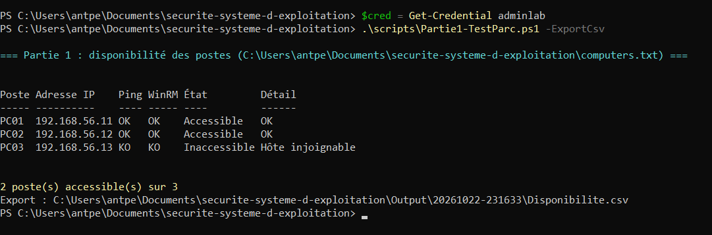{width=14cm}

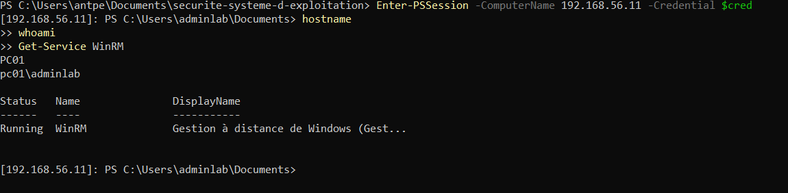{width=14cm}

**Quel est le rôle de WinRM dans PowerShell Remoting ?**
WinRM (*Windows Remote Management*) est l'implémentation par Microsoft du protocole standard
**WS-Management** (DMTF), un protocole SOAP transporté par HTTP ou HTTPS. Il sert de **couche de
transport** à PowerShell Remoting : le service WinRM écoute sur le poste distant, reçoit les
requêtes, **authentifie** l'appelant (Kerberos, NTLM/Negotiate, certificat…), vérifie qu'il a le droit
d'utiliser le point de terminaison demandé (*session configuration*), puis démarre un processus hôte
(`wsmprovhost.exe`) qui exécute les commandes PowerShell sous l'identité de l'utilisateur. Les résultats
sont sérialisés (CLIXML) et renvoyés au client, qui les reconstruit en objets « désérialisés ».
Sans WinRM (ou SSH, depuis PowerShell 7), pas de PowerShell Remoting.

**Quelle commande permet d'activer PowerShell Remoting ?**
`Enable-PSRemoting -Force` (en administrateur). Elle démarre le service WinRM et le passe en démarrage
automatique, crée un écouteur HTTP sur le port 5985, crée les règles de pare-feu entrantes, enregistre
les points de terminaison PowerShell et, en groupe de travail, positionne `LocalAccountTokenFilterPolicy`.
Elle échoue si une carte réseau est en profil **Public** (sauf `-SkipNetworkProfileCheck`).
`winrm quickconfig` configure uniquement la couche WinRM. Sur Windows Server, le remoting est activé
par défaut.

**Quels ports réseau sont utilisés par WinRM ?**
**TCP 5985** pour HTTP et **TCP 5986** pour HTTPS (WinRM 2.0 et ultérieurs ; les anciennes versions
utilisaient 80 et 443). En HTTP, le contenu est tout de même chiffré par la couche d'authentification
(Kerberos ou NTLM), mais le serveur n'est pas authentifié par certificat ; HTTPS ajoute TLS et
l'authentification du serveur.

**Pourquoi le pare-feu Windows peut-il empêcher une connexion PowerShell distante ?**
Le pare-feu Windows Defender bloque par défaut tout trafic **entrant** non explicitement autorisé. Si
WinRM n'a pas été activé, aucune règle n'ouvre le port 5985. Même activé, la règle « Gestion à distance
de Windows (HTTP-In) » dépend du **profil réseau** : sur le profil Public, elle est limitée au
sous-réseau local ou désactivée. Une règle restreinte à certaines adresses sources (ce que nous
configurons volontairement) rejette tout autre client. Enfin, un pare-feu réseau intermédiaire peut
filtrer le port. Côté client, l'erreur est alors un délai d'attente : « WinRM cannot complete the operation ».

**Quelle différence entre Test-Connection et Test-WSMan ?**
`Test-Connection` envoie des requêtes **ICMP Echo** (ping, couche 3) : il indique seulement que l'hôte est
joignable **et** que l'ICMP n'est pas filtré. Il ne dit rien de WinRM et peut donner des faux négatifs,
car Windows bloque le ping entrant par défaut. `Test-WSMan` envoie une requête **WS-Management Identify**
au service WinRM (TCP 5985/5986) : il prouve que le port est ouvert, que le pare-feu laisse passer et
que le service répond au protocole (il renvoie la version de la pile). Avec `-Credential` et
`-Authentication`, il valide aussi l'authentification. Une machine peut répondre au ping sans offrir
WinRM, et inversement. Notre script combine les deux et considère un poste **accessible si WinRM répond**,
même si le ping est filtré ; il indique la cause précise : hôte injoignable, WinRM fermé ou ICMP filtré.

**Pourquoi vérifier l'accessibilité d'une machine avant de tenter une commande distante ?**
- **Performance** : une connexion WinRM vers une machine éteinte attend un délai d'expiration de
  plusieurs dizaines de secondes. Sur un grand parc, l'audit deviendrait très long. Notre test TCP
  prend au plus 2 s.
- **Robustesse** : un échec traité en amont n'interrompt pas l'audit des autres postes.
- **Diagnostic** : distinguer « poste éteint », « WinRM désactivé ou filtré » et « accès refusé »
  donne à l'administrateur l'action corrective à mener.
- **Sécurité** : on évite d'envoyer des identifiants (NTLM) à une adresse qui ne répond pas comme
  attendu, et l'on journalise proprement l'état de chaque poste.

**Quels problèmes de sécurité si PowerShell Remoting est activé sans restriction ?**
- **Exécution de code à distance pour quiconque possède des identifiants administrateur** : un
  attaquant ayant volé un compte (hameçonnage, *pass-the-hash*) peut exécuter n'importe quel code sur
  tout le parc avec `Invoke-Command`. C'est un vecteur classique de **mouvement latéral**
  (MITRE ATT&CK T1021.006).
- **Surface d'attaque réseau** : port 5985 ouvert à tout le sous-réseau, voire à tous en profil Public,
  ce qui expose le service aux attaques par force brute ou pulvérisation de mots de passe.
- **Authentification faible** : Basic + `AllowUnencrypted` transmettent le mot de passe en clair ;
  NTLM n'authentifie pas le serveur et est sensible au relais.
- **`TrustedHosts = *`** : le client accepte d'envoyer ses identifiants NTLM à n'importe quel hôte,
  y compris à un serveur malveillant qui se fait passer pour un poste du parc.
- **CredSSP** : les identifiants sont délégués et exposés en mémoire sur le poste distant.
- **`LocalAccountTokenFilterPolicy = 1`** : tout administrateur local obtient un jeton complet à
  distance, ce qui facilite le *pass-the-hash* avec des comptes locaux de même mot de passe.
- **Droits trop larges** : point de terminaison accessible à des groupes non administrateurs, absence
  de restriction des commandes.
- **Absence de traçabilité** : sans journalisation PowerShell, les actions distantes sont invisibles.
  Le moteur PowerShell 2.0, s'il est présent, permet de contourner AMSI et la journalisation.

### Partie 2 — Inventaire du parc

**Réalisation** : `scripts/Partie2-Inventaire.ps1` → `Inventory.csv`.

Pour chaque poste de `computers.txt` : nom, IP, état (Accessible/Inaccessible), état du ping, et pour
les postes accessibles :

| Information demandée | Source |
|---|---|
| Nom du poste | `Win32_ComputerSystem.Name` (comparé au nom de `computers.txt`, écart signalé) |
| Modèle | `Win32_ComputerSystem.Manufacturer/Model` |
| Version du BIOS | `Win32_BIOS.SMBIOSBIOSVersion` |
| Version et édition de Windows | `Win32_OperatingSystem.Caption` + `DisplayVersion` (ex. 24H2) + build et révision (UBR) |
| Architecture | `Win32_OperatingSystem.OSArchitecture` |
| Dernier démarrage | `Win32_OperatingSystem.LastBootUpTime` |
| Mémoire RAM | `Win32_ComputerSystem.TotalPhysicalMemory` |
| Espace libre du disque système | `Win32_LogicalDisk` (lecteur système), en Go et en % |
| Date de la dernière mise à jour | Correctif le plus récent (Get-HotFix + historique Windows Update) |
| Nombre de mises à jour installées | Nombre de KB distinctes installées |
| État du service Windows Update | `Get-Service wuauserv` : état **et** type de démarrage |
| *(bonus)* Redémarrage en attente | Clés `RebootRequired` / `RebootPending` |

Le script continue lorsqu'un poste est inaccessible ou qu'une commande échoue : l'erreur est
enregistrée dans la colonne **Erreur** de l'inventaire. Le collecteur protège chaque section par un
`try/catch` : si l'historique Windows Update est inaccessible, le reste de l'inventaire est conservé.

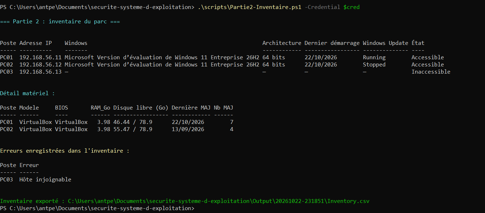{width=16cm}

### Partie 3 — Inventaire des correctifs

**Réalisation** : `scripts/Partie3-Correctifs.ps1` → `PatchesInventory.csv`, `PatchesSummary.csv` ;
`scripts/Rechercher-KB.ps1 -KB KBxxxxxxx` recherche un correctif précis sur tout le parc.

1. **Liste locale** : `Get-HotFix`, trié par date décroissante.
2. **Informations par correctif** : `HotFixID` (numéro de KB), `Description` (*Security Update*,
   *Update*…), `InstalledOn` (date d'installation) et `InstalledBy` (compte ayant installé le correctif,
   souvent `NT AUTHORITY\SYSTEM`). Ce dernier champ est souvent vide : Windows Update ne le renseigne
   pas toujours, d'où la mention « lorsque l'information est disponible » dans l'énoncé.
3. **Collecte à distance** via les sessions PowerShell Remoting, en parallèle.
4. Les postes inaccessibles sont **ignorés proprement** : avertissement et ligne de journal, sans
   interruption.
5. **Inventaire** : Poste, Adresse IP, KB, Description, Date d'installation, Installé par, Source.
6. **`PatchesInventory.csv`** trié par poste puis par date décroissante. La synthèse par poste donne le
   nombre de correctifs, la date du plus récent et son numéro de KB.

**Complément** : `Get-HotFix` (classe `Win32_QuickFixEngineering`) ne voit que les correctifs gérés
par CBS. Nous le complétons par l'**historique de l'agent Windows Update** (API COM
`Microsoft.Update.Session`). Un KB issu de l'historique n'est retenu que si sa **dernière** opération est
une installation réussie : une désinstallation ultérieure l'annule. Cela couvre notamment les mises à
jour de Defender ou de .NET.

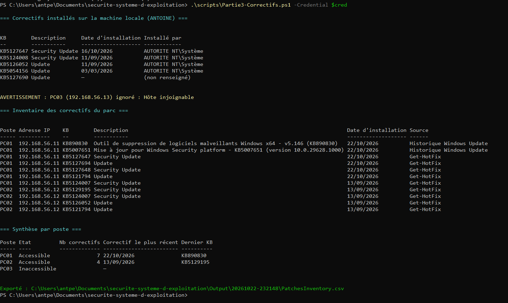{width=16cm}

### Partie 4 — Contrôle de conformité

**Réalisation** : `scripts/Partie4-Conformite.ps1` → `ComplianceReport.csv`.

1. **`required-patches.txt`** : une ligne par correctif obligatoire, `KB;Description;Cible`. Le champ
   **Cible**, optionnel, est un motif comparé à la version de Windows du poste (`*Windows 11*`) : un
   correctif cumulatif Windows 10 n'est pas exigé d'un poste Windows 11. Les KB invalides et les
   doublons sont signalés et ignorés.
2. Pour chaque poste accessible, les correctifs installés sont comparés aux correctifs applicables.
3. **États** : **CONFORME** uniquement si tous les correctifs applicables sont installés,
   **NON CONFORME** sinon, **INACCESSIBLE** si le poste n'a pas pu être audité. Par principe de sécurité
   (*fail secure*), un poste dont on ne connaît pas la version de Windows se voit appliquer tous les
   correctifs, et un poste dont l'inventaire des correctifs a échoué ne peut pas être déclaré conforme.
4. La **liste précise des KB manquantes** et la **date et l'heure du contrôle** figurent dans le rapport.
5. Export dans **`ComplianceReport.csv`**.
6. **Taux global de conformité** = conformes / (conformes + non conformes) × 100, **sans les postes
   inaccessibles**. On ne peut rien affirmer sur ces derniers, qui sont suivis séparément.

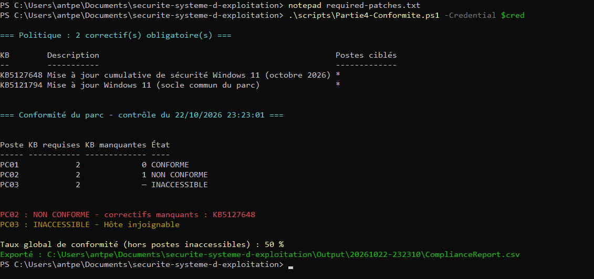{width=16cm}

**7. Pourquoi la politique de conformité doit-elle être régulièrement mise à jour ?**
- **De nouvelles vulnérabilités sont publiées en permanence** : Microsoft publie ses correctifs chaque
  deuxième mardi du mois (*Patch Tuesday*), ainsi que des correctifs **hors cycle** pour les failles
  activement exploitées (par exemple PrintNightmare, CVE-2021-34527). Une politique figée garantit au
  mieux la protection contre les failles d'hier : un parc « 100 % conforme » à une politique périmée
  donne un **faux sentiment de sécurité**.
- **Remplacement des correctifs (*supersedence*)** : les mises à jour cumulatives remplacent les
  précédentes. Un ancien KB n'est plus proposé et un poste à jour peut ne pas l'avoir. La politique doit
  donc exiger le **dernier** correctif cumulatif, sinon elle produit de faux « non conformes ».
- **Évolution du parc** : nouvelles versions de Windows (23H2 → 24H2), nouveaux postes, fin de support
  d'une version qui ne reçoit plus aucun correctif.
- **Priorisation selon le risque** : sévérité CVSS, exploitation active (catalogue CISA KEV), exposition
  des postes, conformément à la notion de niveau de durcissement du cours.
- **Retrait de correctifs défectueux** : un correctif peut être retiré ou remplacé par Microsoft.

C'est l'application concrète du principe de **veille et maintenance** : la politique doit être revue au
minimum à chaque Patch Tuesday, à partir des bulletins MSRC et des alertes CERT-FR.

### Partie 6 — Rapport de sécurité

**Réalisation** : `Invoke-PatchAudit.ps1` produit dans `Output\<date>\` :

| Fichier | Contenu |
|---|---|
| `SecurityReport.csv` / `.html` | Par poste : nom, IP, accessibilité, version de Windows, dernier démarrage, état de Windows Update, nombre de correctifs requis et manquants, liste des KB manquantes, conformité, date et heure du contrôle |
| `ParcSummary.csv` | Synthèse globale : nombre total de postes, accessibles, inaccessibles, conformes, non conformes, total de correctifs manquants, taux de conformité |
| `Interventions.csv` | **Uniquement les postes nécessitant une intervention**, avec le motif et l'action recommandée |
| `SHA256SUMS.txt` | Empreintes d'intégrité de tous les fichiers |

Le **rapport HTML** est autonome (CSS intégré, aucune ressource externe, imprimable). Il présente des
cartes de synthèse avec une jauge du taux de conformité, la section « Postes nécessitant une
intervention », le détail par poste avec des badges colorés, des **points d'attention complémentaires**
(service Windows Update désactivé, redémarrage en attente, disque presque plein, absence de redémarrage
depuis plus de 30 jours) et la politique appliquée. Un exemple, généré avec des données fictives, se
trouve dans `examples/SecurityReport.html`.

**Journal `Logs\PatchManager.log`** — format conforme à l'énoncé :

```
06/10/2026 09:00:01 ; Début de l'audit
06/10/2026 09:00:01 ; Opérateur PC-ADMIN\admin depuis PC-ADMIN
06/10/2026 09:00:01 ; Inventaire chargé : 3 poste(s) ; politique : 3 correctif(s) obligatoire(s)
06/10/2026 09:00:03 ; PC01 ; Accessible
06/10/2026 09:00:03 ; PC02 ; Accessible
06/10/2026 09:00:03 ; PC03 ; Inaccessible ; Hôte injoignable
06/10/2026 09:00:05 ; PC01 ; Conforme
06/10/2026 09:00:05 ; PC02 ; Non conforme ; KB5063878
06/10/2026 09:00:06 ; Rapport généré (…\Output\20261006-090001)
06/10/2026 09:00:07 ; Notification envoyée à admin@entreprise.local
06/10/2026 09:00:07 ; Empreinte SHA-256 du manifeste 20261006-090001 : 3f1c…
06/10/2026 09:00:07 ; Fin de l'audit
```

Le journal est en **ajout seul** : il n'est jamais réécrit. Les retours à la ligne présents dans les
données sont neutralisés, ce qui empêche d'injecter de fausses lignes. Les erreurs sont préfixées par
`ERREUR`.

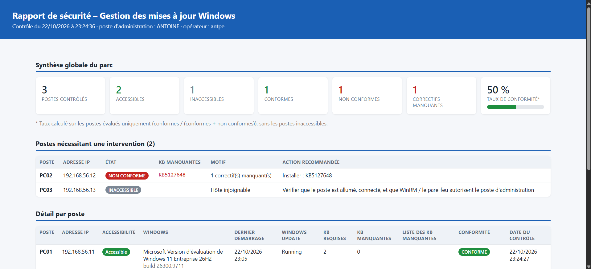{width=16cm}

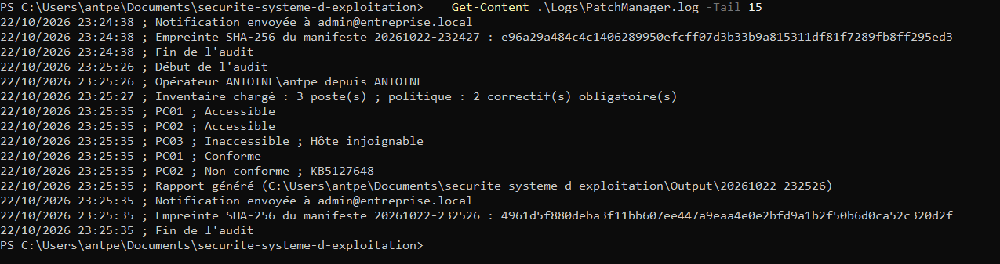{width=16cm}

### Partie 7 — Notification

**Réalisation** : `Send-PMNotification`, appelée automatiquement en fin d'audit.

1. **Détection** : si aucun poste n'est NON CONFORME ou INACCESSIBLE, aucune notification n'est
   envoyée et le journal indique « Aucune anomalie détectée ». Sinon, le message est construit
   automatiquement :

   ```
   Objet : [PATCH MANAGEMENT] Anomalies détectées

   Date du contrôle : 06/10/2026 09:00

   Postes contrôlés            : 3
   Postes non conformes        : 1
   Postes inaccessibles        : 1

   PC02 (192.168.56.12) : NON CONFORME
          KB5063878 manquante

   PC03 (192.168.56.13) : INACCESSIBLE
          Hôte injoignable
   ```

   Le **rapport HTML (et le CSV) est joint**. Aucun mot de passe ne figure dans le script ni dans la
   configuration : les identifiants SMTP sont stockés **chiffrés par DPAPI**
   (`setup/Save-PMSecret.ps1`, `Export-Clixml`), déchiffrables uniquement par le même compte sur le même
   poste. Le résultat est journalisé : `Notification envoyée à admin@entreprise.local` ou
   `ERREUR ; Notification non envoyée ; <cause>`. Le message est aussi conservé dans `Notification.txt`.
   Trois méthodes sont configurables : `Smtp`, `Webhook` (Teams, Slack…) et `File`.
   La démonstration utilise le serveur SMTP de test **Papercut**.

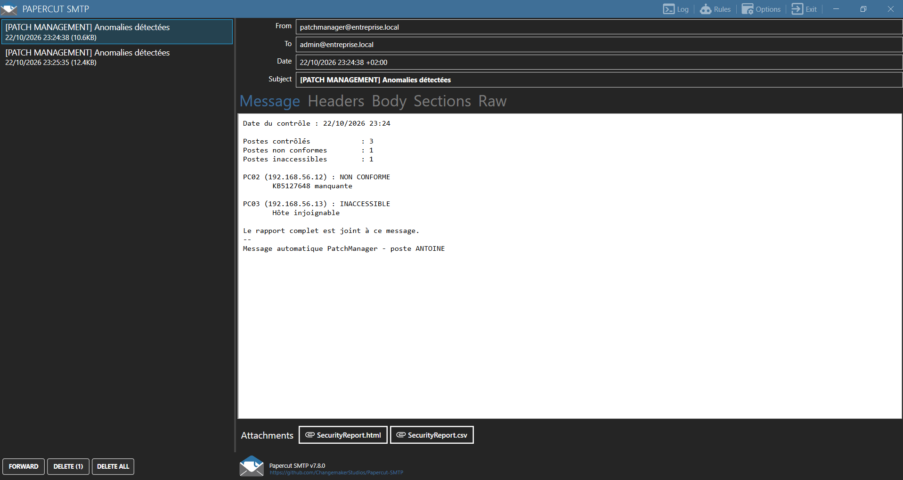{width=16cm}

**2. Inconvénients de cette solution**
- **Gestion d'un secret** : même chiffré par DPAPI, l'identifiant SMTP est lié à un compte et à un
  poste, doit être renouvelé et reste exploitable par un attaquant qui contrôle ce compte.
- **`Send-MailMessage` est obsolète** : Microsoft indique qu'il ne garantit pas une connexion sécurisée.
  De plus, l'authentification SMTP « basique » est désactivée sur Exchange Online, au profit d'OAuth 2.0.
- **Données sensibles dans la messagerie** : le rapport décrit précisément les faiblesses du parc. Il est
  copié dans des boîtes aux lettres, parfois transféré, et circule en clair si TLS n'est pas imposé.
- **Fiabilité** : pas d'accusé de réception ni de reprise. Si le serveur SMTP ou le poste
  d'administration est indisponible, aucune alerte n'arrive, et **l'absence d'alerte peut être
  confondue avec l'absence de problème**.
- **Exploitation** : pas de suivi, d'escalade ni de dédoublonnage. Une alerte quotidienne identique
  entraîne une « fatigue d'alerte ». Pas d'historique centralisé ni de lien avec la gestion des tickets.
- **Port SMTP souvent filtré** (25/587) et messages parfois classés en indésirables.

**3. Alternatives modernes**
- **Microsoft Graph API** (`sendMail`) avec une application Entra ID authentifiée par certificat ou par
  identité managée : OAuth 2.0, aucun mot de passe.
- **Webhooks / messagerie collaborative** : Teams (Workflows / Power Automate), Slack. La méthode
  `Webhook` est déjà implémentée.
- **Journaux centralisés et SIEM** : écrire les anomalies dans le journal d'événements Windows,
  centraliser avec Windows Event Forwarding, puis alerter depuis Microsoft Sentinel, Splunk, Wazuh ou
  Elastic. Les alertes y sont corrélées, historisées et protégées.
- **Supervision** : Zabbix, Centreon, Nagios ou PRTG exploitent le **code de sortie** du script
  (0 = conforme, 1 = anomalies, déjà implémenté).
- **Gestion des tickets** : création automatique d'un ticket GLPI ou ServiceNow par poste non conforme.
- **Outils de Patch Management dédiés** : WSUS, Microsoft Configuration Manager (MECM),
  Intune + rapports Windows Update for Business, Azure Update Manager, Microsoft Defender Vulnerability
  Management. Ils intègrent le déploiement des correctifs, les rapports et les alertes.
- **Coffre de secrets** : module `Microsoft.PowerShell.SecretManagement`, Azure Key Vault, ou compte de
  service géré (gMSA) en domaine.

---

## 5. Sécurisation de la solution (Partie 8)

### 5.1 Principaux risques liés à PowerShell Remoting / WinRM dans notre architecture

| Risque | Impact | Mesure mise en œuvre |
|---|---|---|
| Vol des identifiants du compte de Patch Management | Exécution de code sur tout le parc (mouvement latéral) | Compte **non administrateur** + **JEA** (une seule commande en lecture seule) ; secrets DPAPI |
| Port WinRM accessible depuis tout le réseau | Force brute, exploitation du service | Pare-feu limité à l'IP du poste d'administration ; règle Public désactivée |
| Usurpation d'un poste / relais NTLM | Vol d'identifiants, faux résultats | `TrustedHosts` restreint ; HTTPS avec certificat (option) ; Kerberos en domaine |
| Authentification faible (Basic, flux non chiffré, CredSSP) | Mot de passe en clair, délégation exposée | Basic, CredSSP et `AllowUnencrypted` désactivés (client et serveur) |
| Compromission du poste d'administration | Accès à tout le parc | Poste dédié, moindre privilège de l'opérateur, journalisation, JEA côté postes |
| Fuite des rapports | Cartographie des faiblesses du parc | ACL restrictives, `.gitignore`, diffusion restreinte |
| Altération des rapports ou du journal | Masquage d'un poste vulnérable | Journal en ajout seul, refus de suppression, empreintes SHA-256, centralisation |
| Données malveillantes renvoyées par un poste compromis | XSS dans le rapport, formule Excel | Encodage HTML, neutralisation des formules CSV |
| Absence de traçabilité | Actions distantes invisibles | Script Block Logging, transcription, transcriptions JEA, journal WinRM |

### 5.2 Vérifier quels utilisateurs peuvent ouvrir une session distante

```powershell
Get-PSSessionConfiguration | Format-Table Name, Permission -Wrap
Get-LocalGroupMember -SID S-1-5-32-544   # Administrateurs
Get-LocalGroupMember -SID S-1-5-32-580   # Utilisateurs de gestion à distance
Set-PSSessionConfiguration -Name Microsoft.PowerShell -ShowSecurityDescriptorUI   # interface graphique
```

Par défaut, le point de terminaison `Microsoft.PowerShell` est accessible aux **Administrateurs** et aux
**Utilisateurs de gestion à distance**. Le script `scripts/Partie8-AuditRemoting.ps1` automatise ces
contrôles sur tout le parc et signale les permissions trop larges (*Tout le monde*,
*Utilisateurs authentifiés*). Les groupes sont désignés par **SID**, ce qui rend les scripts
indépendants de la langue de Windows.

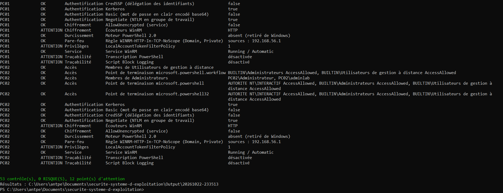{width=16cm}

Les 12 points d'attention relevés sur le laboratoire sont attendus et expliqués : écouteurs en HTTP et
non en HTTPS (flux tout de même chiffré par NTLM), `LocalAccountTokenFilterPolicy = 1` sur les VM
(nécessaire en groupe de travail ; c'est précisément ce que JEA permet d'éviter), et journalisation
PowerShell non encore activée lors de ce premier passage (activée ensuite par
`Enable-PSAuditLogging.ps1`). Le moteur PowerShell 2.0 est signalé « absent » : Windows 11 26H2 ne
l'inclut plus.

### 5.3 Limiter les privilèges du compte de Patch Management

- Compte dédié **`svc-patchaudit`**, **non administrateur**, membre du seul groupe local `PatchAuditors`.
- Ce compte n'est pas membre de *Utilisateurs de gestion à distance* : il **ne peut pas** ouvrir de
  session sur le point de terminaison standard, seulement sur `PatchAudit` (JEA). Testé en CI.
- La collecte est en **lecture seule** : le collecteur ne modifie rien sur les postes.
- Côté poste d'administration, la tâche planifiée s'exécute avec `RunLevel Limited`. Un compte
  distinct du compte personnel de l'administrateur est recommandé.
- Recommandations complémentaires : interdire l'ouverture de session locale et RDP à ce compte
  (stratégie locale « Interdire l'ouverture d'une session locale »), mot de passe long et unique par
  poste (LAPS pour les comptes locaux), compte de service géré (gMSA) en domaine.

### 5.4 Fichiers accessibles uniquement aux utilisateurs autorisés

`setup/Protect-PMData.ps1` désactive l'héritage sur `Output`, `Logs` et `secrets` et n'accorde l'accès
qu'à SYSTEM, aux Administrateurs et au compte opérateur. Le groupe *Utilisateurs* n'a plus aucun droit.
Pour `Logs`, un **refus explicite de suppression** est appliqué à l'opérateur : le script peut ajouter des
lignes, mais pas effacer l'historique. `secrets` est réservé à l'opérateur et à SYSTEM.
Vérification : `icacls .\Logs`. Les résultats et les secrets sont exclus du dépôt Git (`.gitignore`).

### 5.5 Règles du pare-feu associées à WinRM

```powershell
Get-NetFirewallRule -Name 'WINRM-HTTP-In-TCP*' |
  Select-Object Name, Enabled, Profile, @{n='Sources';e={($_ | Get-NetFirewallAddressFilter).RemoteAddress}}
```

Par défaut, `Enable-PSRemoting` crée une règle sans restriction de source (*Any*) pour les profils
Domaine et Privé, et une règle limitée au sous-réseau local pour le profil Public.
`Initialize-ManagedNode.ps1` restreint ces règles à l'**adresse du poste d'administration**
(`Set-NetFirewallRule -RemoteAddress 192.168.56.1`), désactive la règle Public et n'autorise le ping que
depuis ce même poste. Toute autre machine du réseau est rejetée. C'est l'application de la
**minimisation de la surface d'attaque**.

### 5.6 Mode d'authentification ; quand Kerberos est préférable

Vérification côté serveur : `Get-ChildItem WSMan:\localhost\Service\Auth`. Méthode effectivement
utilisée par une session :

```powershell
Invoke-Command -ComputerName 192.168.56.11 -Credential $cred { [Security.Principal.WindowsIdentity]::GetCurrent().AuthenticationType }
```

Dans notre laboratoire (groupe de travail, connexion **par adresse IP**), le résultat est **NTLM**
(via Negotiate) : Kerberos exige un domaine et un nom d'hôte associé à un SPN, ce qu'une adresse IP ne
permet pas. C'est pourquoi `TrustedHosts` doit lister explicitement les postes.

**Kerberos est préférable dès que les machines sont dans un domaine Active Directory** et que l'on se
connecte par leur **nom** (`ConnectBy = 'Name'` dans la configuration) :
- **authentification mutuelle** : le client vérifie l'identité du serveur, ce qui empêche l'usurpation
  et rend `TrustedHosts` inutile ;
- **aucun mot de passe ni condensat** ne transite : seulement des tickets chiffrés à durée limitée ;
- résistance au **relais NTLM** et au *pass-the-hash* ;
- gestion centralisée : révocation du compte, politiques de mots de passe, délégation contrainte.

Hors domaine, la meilleure alternative est **HTTPS (5986) avec un certificat** reconnu par le poste
d'administration (`-EnableHttps`), qui apporte l'authentification du serveur.

### 5.7 Just Enough Administration (JEA)

JEA est une technologie PowerShell de **délégation d'administration au strict nécessaire**. Un
point de terminaison JEA est une configuration de session qui :
- définit des **rôles** (fichiers `.psrc`) listant précisément les cmdlets, fonctions et paramètres
  autorisés, avec des valeurs éventuellement contraintes ;
- associe des **groupes d'utilisateurs** à ces rôles (`RoleDefinitions` dans le `.pssc`) ;
- exécute la session en mode **NoLanguage** : aucun script arbitraire, aucune variable, aucune
  construction de langage ;
- exécute les commandes sous un **compte virtuel** temporaire privilégié (ou un gMSA), sans que
  l'utilisateur connaisse ou possède ces privilèges ;
- **enregistre une transcription** de chaque session.

**Mise en œuvre dans le projet** (`jea/`) :
- module `PatchAuditJEA` contenant **la même fonction `Get-PatchAuditData`** que le mode standard (source
  unique) ;
- rôle `PatchAuditor.psrc` : `VisibleFunctions = 'Get-PatchAuditData'`, aucun cmdlet supplémentaire ;
- `Install-PatchAuditJEA.ps1` : crée le groupe `PatchAuditors` et le compte `svc-patchaudit`, génère le
  `.pssc` (`RestrictedRemoteServer`, `RunAsVirtualAccount`, transcriptions dans
  `C:\ProgramData\PatchAuditJEA\Transcripts`) et l'enregistre sous le nom `PatchAudit` ;
- côté administration : `ConfigurationName = 'PatchAudit'`. PatchManager détecte le mode JEA et
  appelle simplement `Get-PatchAuditData`.

**Vérifié automatiquement en CI** : avec le compte non administrateur, `Get-Command` ne montre que
`Get-PatchAuditData` et les commandes minimales de session, `Get-Service` est refusé, le point de
terminaison standard est refusé, et l'audit complet via JEA donne le même résultat qu'avec un compte
administrateur. Un vol des identifiants de `svc-patchaudit` ne permet donc **que de lire l'inventaire
des correctifs**.

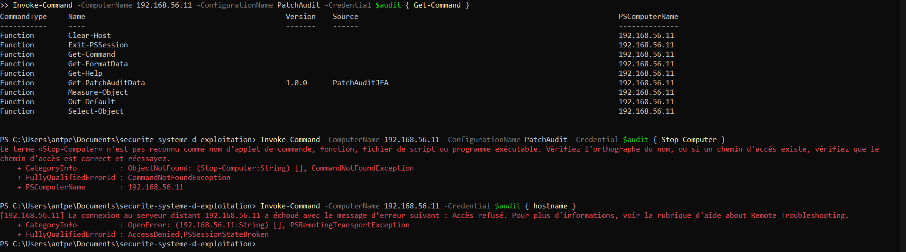{width=16cm}

### 5.8 Stratégie de conservation des rapports et journaux

| Objectif | Mesures |
|---|---|
| **Empêcher la modification non autorisée** | ACL restrictives ; journal en ajout seul ; **manifeste SHA-256** par audit (`SHA256SUMS.txt`), dont l'empreinte est inscrite dans le journal ; `scripts/Verifier-Integrite.ps1` détecte tout fichier modifié, supprimé ou ajouté (testé) ; copie vers un stockage à écriture unique (WORM, stockage immuable, sauvegarde hors ligne) |
| **Empêcher la suppression** | Refus explicite de suppression sur `Logs` ; **centralisation en temps réel** des journaux (Windows Event Forwarding, syslog, SIEM) sur un serveur que l'opérateur ne peut pas modifier, comme vu en cours (« déport des journaux ») ; sauvegardes régulières |
| **Éviter l'exposition d'informations sensibles** | Aucun secret dans les rapports, la configuration ou le dépôt (`.gitignore`, DPAPI) ; accès réservé aux administrateurs ; rapports marqués « diffusion restreinte » ; chiffrement du disque (BitLocker) ; pièces jointes envoyées uniquement en interne, par TLS |
| **Durée de conservation** | `RetentionDays = 180` : purge automatique des rapports anciens (`Remove-PMExpiredRun`), journal conservé au moins 1 an pour les besoins d'enquête, durée à aligner sur la politique de l'entreprise |

### 5.9 Traçabilité complémentaire

`setup/Enable-PSAuditLogging.ps1` active sur les postes le **Script Block Logging** (événement 4104),
le **Module Logging** (4103), la **transcription** vers un dossier protégé et le journal opérationnel
WinRM. L'option `-DisablePowerShellV2` supprime le moteur 2.0, qui permettrait de contourner ces
mécanismes. C'est la **défense en profondeur** : même si une couche est contournée, l'action reste visible.

---

## 6. Bonus : remédiation automatique et suivi de la conformité dans le temps

L'énoncé saute de la partie 4 à la partie 6. La « partie 5 » logique d'une démarche de Patch
Management est la **correction** des postes non conformes. Elle fait l'objet du premier bonus. Le
second bonus apporte le **suivi dans le temps**, indispensable à l'activité de veille et maintenance.

### 6.1 Bonus 1 — Remédiation (`scripts/Bonus-Remediation.ps1`, `Invoke-PMRemediation`)

La boucle complète devient : **détecter → corriger → re-vérifier**.

1. Le script lit le dernier `ComplianceReport.csv` et ne retient que les postes **NON CONFORMES**, avec
   pour chacun la liste de ses KB manquantes.
2. Sur chaque poste, il installe **uniquement ces KB**, ou bien, sans politique, les mises à jour des
   classifications *Sécurité* et *Critiques*.
3. Avec `-AuditAfter`, il relance un audit complet pour **prouver** que le poste est devenu conforme.

**Difficulté technique résolue.** L'API Windows Update (`Microsoft.Update.Session`) refuse de
télécharger ou d'installer des mises à jour depuis une session WinRM (erreur `0x80070005`, accès
refusé). La fonction dépose donc sur le poste un petit script, l'exécute via une **tâche planifiée
temporaire sous le compte SYSTEM**, attend son résultat (fichier JSON), puis **supprime la tâche et le
script** dans un bloc `finally`. Ce mécanisme est vérifié en intégration continue, en mode recherche, sur
une vraie machine Windows : la tâche s'exécute sous SYSTEM, renvoie son résultat et est bien supprimée.

**Sécurité de la remédiation.**
- C'est une action qui **modifie** les postes : confirmation obligatoire (`ConfirmImpact = High`),
  simulation avec `-WhatIf`, et mode `-ScanOnly` qui ne fait que rechercher.
- **Séparation des rôles** : le compte JEA d'audit est en lecture seule et ne peut pas corriger. La
  remédiation exige le point de terminaison administrateur, donc une autre identité. Un attaquant qui
  volerait le compte d'audit ne pourrait rien installer.
- Le **redémarrage n'est jamais automatique** (option `-AllowReboot`, avec un préavis de 5 minutes),
  pour ne pas interrompre les utilisateurs ou les applications métier.
- Les postes injoignables sont ignorés sans bloquer les autres, et chaque action est journalisée :
  `PC02 ; Remédiation terminée : 1 trouvée(s), 1 installée(s), 0 échec(s)`.

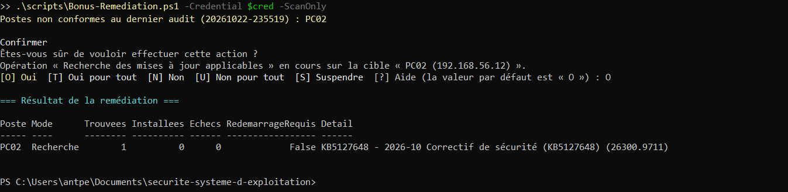{width=16cm}

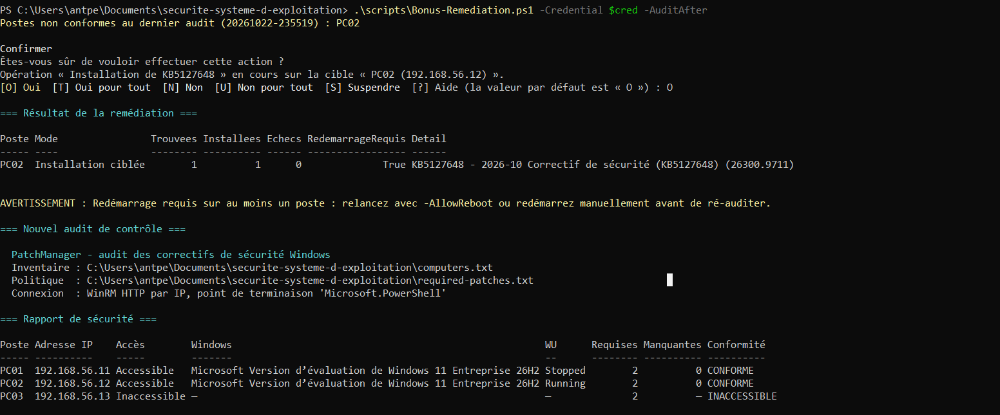{width=16cm}

**Résultat sur le laboratoire** : KB5127648 a été installée sur PC02 par la tâche SYSTEM temporaire
(1 trouvée, 1 installée, 0 échec, redémarrage requis signalé). L'audit relancé automatiquement donne
2 postes conformes sur 2 évalués, soit 100 %.

### 6.2 Bonus 2 — Historique et tendance (`Get-PMTrend`, `Add-PMHistory`)

- Chaque audit est ajouté à `Output\History.csv` : date, compteurs et taux de conformité.
- L'audit courant est **comparé au précédent**, poste par poste : **Régression** (un poste conforme ne
  l'est plus), **Corrigé**, **Inchangé** ou **Nouveau** (`Evolution.csv`).
- Le rapport HTML gagne une section « Évolution de la conformité » : variation du taux, régressions,
  postes corrigés et **graphique SVG** des derniers audits, généré en PowerShell sans aucune
  bibliothèque externe.
- Les **régressions sont mises en avant dans la notification** et dans le journal. Un poste qui
  redevient vulnérable est l'information la plus urgente pour l'administrateur.

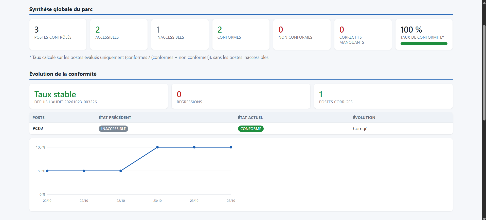{width=16cm}

Pendant le redémarrage de PC02, un audit l'a trouvé injoignable : il a été signalé comme
**régression** (CONFORME → INACCESSIBLE), puis comme **Corrigé** à l'audit suivant, ce qui valide les
deux sens de la comparaison.

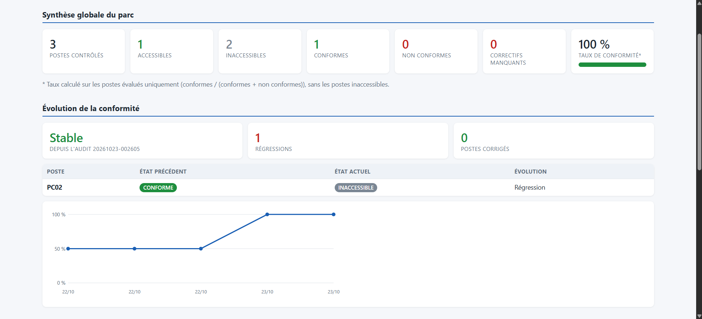{width=16cm}

---

## 7. Choix techniques

| Choix | Justification |
|---|---|
| **Module PowerShell** (`.psd1` + fonctions par domaine) plutôt qu'un script monolithique | Lisibilité, réutilisation par les scripts de chaque partie, testabilité (Pester) |
| **Compatibilité Windows PowerShell 5.1** | Version présente par défaut sur tous les Windows 10/11 : aucune installation requise sur les postes |
| **Collecteur unique `Get-PatchAuditData`** | Même code en mode standard, local et JEA : pas de divergence possible |
| **Sortie « à plat » typée (`RecordType`)** | PowerShell Remoting ne sérialise fidèlement qu'un niveau de propriétés. Un objet contenant un tableau de correctifs arriverait sous forme de chaînes. Le collecteur émet donc un enregistrement par correctif |
| **Test TCP du port WinRM avec délai de 2 s avant connexion** | Évite les longs délais d'attente sur les postes éteints |
| **WinRM fait foi, pas le ping** | Windows bloque l'ICMP par défaut : se fier au ping produirait de faux « inaccessibles » |
| **Sessions parallèles** (`Invoke-Command -Session $all -ThrottleLimit 16`) | Collecte en un seul aller-retour par poste, en parallèle : passage à l'échelle |
| **Sessions fermées dans un bloc `finally`** | Pas de session orpheline sur les postes |
| **Poste local audité sans WinRM** | Le poste d'administration peut figurer dans le parc sans activer WinRM sur lui-même |
| **Get-HotFix + historique Windows Update** | Inventaire plus complet ; gestion des désinstallations |
| **Politique ciblable par version de Windows** | Évite les faux « non conformes » sur un parc hétérogène |
| **CSV avec `;` et UTF-8 avec BOM** | Ouverture directe dans Excel en français, accents corrects |
| **Scripts encodés en UTF-8 avec BOM** | Sans BOM, PowerShell 5.1 lit les scripts en Windows-1252 et corrompt les accents |
| **HTML autonome et données encodées** | Rapport lisible hors ligne, sans dépendance, protégé contre le XSS |
| **Configuration `.psd1` sans secret** | Paramétrage sans modifier le code ; secrets séparés et chiffrés |
| **Code de sortie 0 / 1** | Intégration à une tâche planifiée ou à un outil de supervision |
| **Groupes désignés par SID** | Fonctionne sur un Windows en français (« Administrateurs ») comme en anglais |

---

## 8. Tests effectués

### 8.1 Tests automatisés (Pester) — 50 tests, tous réussis

Exécutables sur n'importe quelle machine, sans laboratoire, grâce à la simulation des commandes réseau
(*mocks*) : `Invoke-Pester -Path .\tests -Output Detailed`.

| Domaine | Cas testés |
|---|---|
| Lecture de `computers.txt` | Commentaires et lignes vides ignorés, espaces supprimés, IP invalide, ligne incomplète, nom invalide, nom et IP en double (5 avertissements), fichier absent |
| Disponibilité | Ping filtré mais WinRM OK → accessible ; ping OK mais WinRM fermé → « WinRM inaccessible » ; hôte injoignable |
| Collecte (WinRM simulé) | Postes accessibles interrogés, session refusée consignée, poste injoignable ignoré, 2 sessions ouvertes, 1 seul `Invoke-Command`, sessions fermées |
| Inventaires | Une ligne par poste ; version et build ; nombre de MAJ ; tri par poste puis date décroissante ; synthèse ; fusion Get-HotFix + historique ; désinstallation et échec ignorés ; KB désinstallé hors Windows Update écarté ; recherche d'un KB |
| Conformité | Normalisation des KB, lignes invalides et doublons ; CONFORME, NON CONFORME (liste exacte), INACCESSIBLE ; ciblage par version de Windows ; horodatage ; taux sans les inaccessibles ; taux N/A |
| Rapport | Champs demandés, synthèse globale, liste des interventions, points d'attention, HTML autonome sans balise injectée (anti-XSS), neutralisation des formules CSV |
| Journal | Format `date ; … ; …`, préfixe `ERREUR`, impossibilité d'injecter une fausse ligne |
| Notification | Aucun envoi sans anomalie ; contenu exact du message ; envoi SMTP avec pièce jointe et destinataire journalisé ; échec SMTP journalisé sans interrompre le script |
| Chaîne complète | Tous les fichiers produits, taux exact, journal dans l'ordre de l'énoncé, CSV lisible, **détection d'un rapport falsifié** (SHA-256), second audit comparé au premier |
| Bonus — tendance | Régression, correction, nouveau poste, variation du taux, absence d'audit précédent, historique CSV, graphique SVG autonome, régression signalée dans la notification |
| Bonus — remédiation | Pilotage à distance avec les KB demandées, poste injoignable ignoré, journalisation, `-WhatIf` sans aucune action, échec d'un poste sans impact sur les autres |

### 8.2 Intégration continue (GitHub Actions, Windows Server)

À chaque commit : analyse statique **PSScriptAnalyzer** (0 avertissement), tests Pester sous
**PowerShell 7** et **Windows PowerShell 5.1**, puis **audit réel** :
1. activation de WinRM ; parc de test composé d'un poste réel joint **par WinRM** et d'un poste
   inexistant (192.0.2.10) ;
2. politique composée d'un KB réellement installé et d'un KB fictif → résultat vérifié : poste réel
   **NON CONFORME** avec uniquement le KB fictif manquant, poste inexistant **INACCESSIBLE**, code de
   sortie 1, inventaire complet ;
3. installation de **JEA**, création d'un compte **non administrateur**, vérification des restrictions et
   audit complet via JEA (inventaire complet vérifié) ;
4. **bonus** : remédiation en mode recherche par tâche planifiée SYSTEM temporaire, puis vérification de
   sa suppression.

### 8.3 Tests manuels sur le laboratoire

| # | Scénario | Résultat attendu | Résultat obtenu |
|---|---|---|---|
| 1 | `Partie1-TestParc.ps1` avec les 3 postes | PC01, PC02 Accessible ; PC03 Inaccessible | OK — PC01, PC02 Accessible ; PC03 Inaccessible « Hôte injoignable » (capture 1) |
| 2 | Ping bloqué sur PC01 (règle ICMP désactivée) | PC01 reste Accessible (« ICMP filtré ») | OK — PC01 : Ping KO, WinRM OK, Accessible, « WinRM OK (ICMP filtré par le pare-feu) » |
| 3 | Service WinRM arrêté sur PC02 | PC02 « WinRM inaccessible », audit poursuivi | OK — PC02 INACCESSIBLE, PC01 audité normalement, notification envoyée |
| 4 | Mauvais mot de passe | « Ouverture de session WinRM refusée », audit poursuivi | OK — PC01 et PC02 : « Ouverture de session WinRM refusée : … Accès refusé », inventaire exporté |
| 5 | Inventaire (partie 2) | Tableau + `Inventory.csv` complets | OK — tableau complet, Inventory.csv exporté (capture 3) |
| 6 | Correctifs (partie 3) | `PatchesInventory.csv` trié, synthèse correcte | OK — PatchesInventory.csv trié par poste puis date, synthèse PC01 : 7, PC02 : 4 (capture 4) |
| 7 | Conformité (partie 4) | PC01 CONFORME, PC02 NON CONFORME, taux 50 % | OK — PC01 CONFORME, PC02 NON CONFORME (KB5127648), PC03 INACCESSIBLE, 50 % (capture 5) |
| 8 | Audit complet | Rapport HTML, journal, notification reçue dans Papercut | OK — rapport HTML, journal complet, courriel reçu avec 2 pièces jointes (captures 6 et 7) |
| 9 | Parc entièrement conforme | Aucune notification, journal « Aucune anomalie » | OK — PC03 retiré : 100 %, « Notification : aucune », journal « Aucune anomalie détectée » |
| 10 | Papercut arrêté | `ERREUR ; Notification non envoyée` | OK — « Notification : NON envoyée », journal « ERREUR ; Notification non envoyée ; Impossible de se connecter au serveur distant » |
| 11 | Connexion depuis une autre machine que le poste d'administration | Refusée par le pare-feu | OK — Test-WSMan depuis PC01 vers PC02 : échec (pare-feu de PC02 limité à 192.168.56.1) |
| 12 | JEA : `Stop-Computer` avec `svc-patchaudit` | Refusé | OK — « Stop-Computer n'est pas reconnu » ; session standard : « Accès refusé » (capture 9) |
| 13 | Modification manuelle d'un CSV puis `Verifier-Integrite.ps1` | Fichier signalé MODIFIÉ | OK — ComplianceReport.csv falsifié signalé MODIFIÉ, les 9 autres fichiers INTACT |
| 14 | Bonus : `Bonus-Remediation.ps1 -ScanOnly` | Liste des mises à jour applicables, aucune installation | OK — PC02 : 1 mise à jour trouvée (KB5127648), aucune installation (capture 10) |
| 15 | Bonus : `Bonus-Remediation.ps1 -AuditAfter` sur PC02 | KB installée, PC02 CONFORME au nouvel audit, « Corrigé » dans l'évolution | OK — KB5127648 installée, PC02 CONFORME, taux 100 %, « Corrigé » dans l'évolution (capture 11) |

### 8.4 Captures des tests manuels

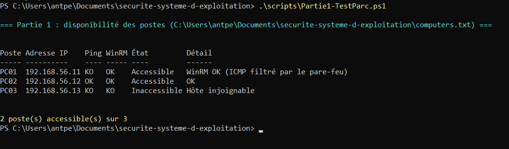{width=13cm}

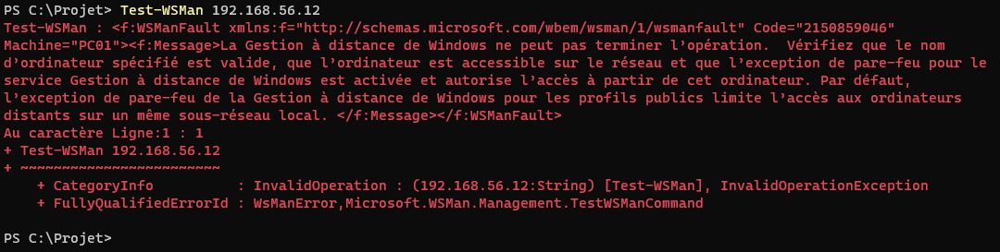{width=14cm}

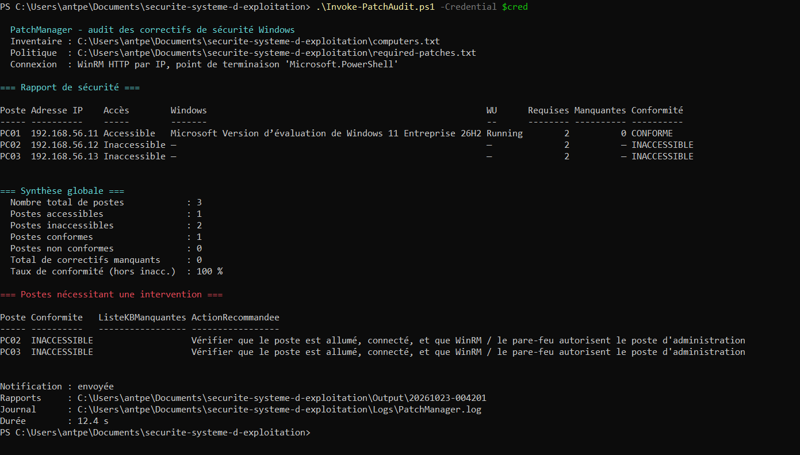{width=15cm}

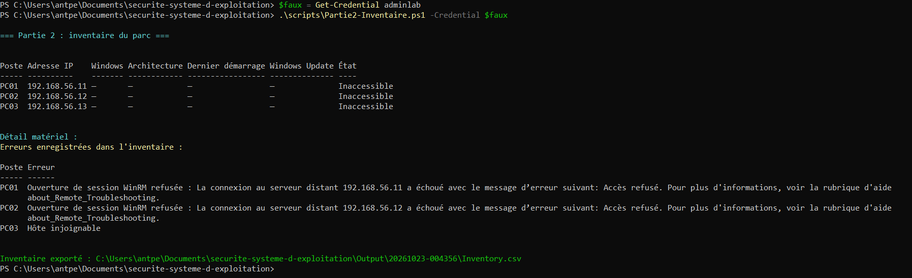{width=16cm}

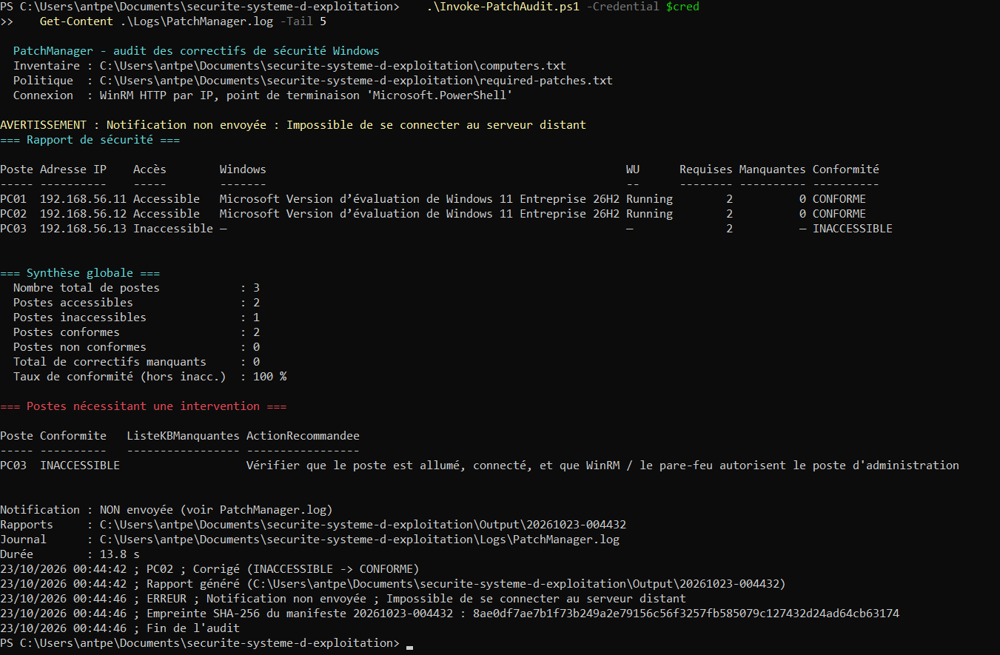{width=15cm}

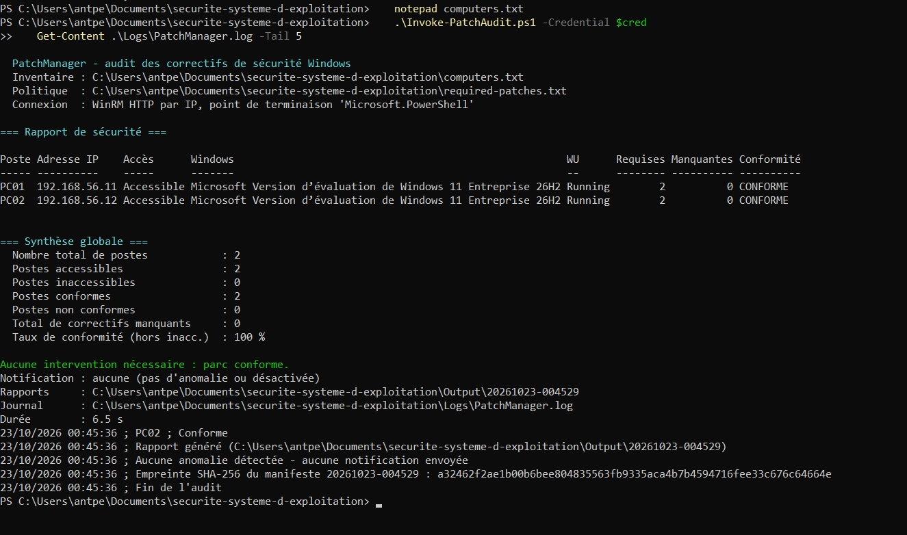{width=15cm}

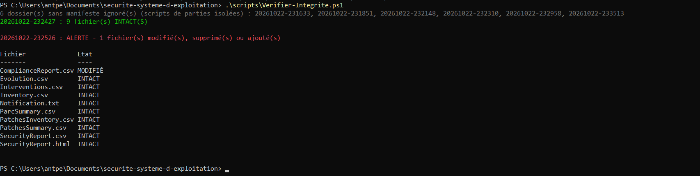{width=16cm}

### 8.5 Problèmes rencontrés sur le laboratoire et corrections

Le passage du code, validé en intégration continue sur Windows Server, à un vrai parc Windows 11 a
révélé plusieurs problèmes, tous corrigés et publiés dans le dépôt :

| # | Problème observé | Cause | Correction |
|---|---|---|---|
| 1 | `Partie3-Correctifs.ps1` s'arrêtait sur la liste locale (« La chaîne n'a pas été reconnue en tant que DateTime valide ») | Un correctif du poste d'administration avait une date `InstalledOn` mal formée ; la propriété lève une exception lors du tri | Conversion protégée de la date avant le tri ; date illisible affichée « — » |
| 2 | `Partie8-AuditRemoting.ps1` s'arrêtait à l'export (« Les types des arguments ne correspondent pas ») | Particularité de PowerShell : `@()` appliqué à une `List[object]` créée par `New-Object` | Liste créée avec `::new()` et convertie avec `.ToArray()` ; `Export-PMCsv` accepte toute collection |
| 3 | La session JEA ne démarrait pas (« l'exécution de scripts est désactivée sur ce système ») | Sur Windows 11, la stratégie d'exécution par défaut est **Restricted** : le module `.psm1` du point de terminaison ne peut pas être chargé (Windows Server, utilisé en CI, est en RemoteSigned) | `Install-PatchAuditJEA.ps1` passe la machine en **RemoteSigned** (scripts locaux autorisés, scripts téléchargés signés) |
| 4 | `Verifier-Integrite.ps1` échouait (« Manifeste absent ») | Il vérifiait le dossier le plus récent, produit par un script de partie isolée, sans manifeste | Vérification de tous les audits complets ; dossiers sans manifeste signalés |
| 5 | Remédiation : erreur Windows Update `0x80240438` puis aucune mise à jour trouvée | Mises à jour **suspendues** sur PC02 (pour simuler un poste non à jour) et DNS du NAT VirtualBox muet | DNS publics sur la carte NAT, reprise des mises à jour ; codes d'erreur Windows Update traduits en cause probable et liste des mises à jour réellement proposées affichée |
| 6 | Rapport HTML : « Stable » affiché en vert malgré une régression | Le taux exclut les postes inaccessibles : un poste devenu injoignable ne change pas le taux | Encart en rouge dès qu'une régression existe ; cause (« Motif ») affichée dans la console |
| 7 | Le lendemain, les VM restaient sur un écran noir au démarrage | Une mise à jour de l'hôte avait activé la « Plateforme de l'hyperviseur Windows » et la « Plateforme d'ordinateur virtuel » : VT-x n'est plus disponible pour VirtualBox, qui bascule sur l'API Hyper-V (journal `VBox.log` : « VT-x is not available », « Snail execution mode ») | Désactivation de ces deux fonctionnalités et de l'intégrité de la mémoire, `bcdedit /set hypervisorlaunchtype off`, redémarrage |
| 8 | VM injoignables par WinRM après la recréation de la carte « réseau privé hôte » | Windows, dans chaque VM, a identifié un nouveau réseau et l'a classé **Public** ; la règle WinRM n'est ouverte que pour les profils Domaine et Privé | `Initialize-ManagedNode.ps1` relancé (idempotent) : profil Privé, règles de pare-feu restaurées |
| 9 | Après désinstallation de KB5127648 sur PC02 (via Paramètres), le poste restait déclaré CONFORME alors que Windows Update proposait à nouveau ce correctif | Une désinstallation faite hors de l'agent Windows Update n'est pas inscrite dans son historique : le KB y apparaissait toujours « installé avec succès » | Le collecteur interroge aussi l'agent Windows Update hors ligne (mises à jour applicables non installées) : un KB à nouveau applicable n'est plus compté comme installé (test Pester ajouté) |

Ces corrections illustrent l'intérêt de tester sur l'environnement cible : chaque cas est désormais
traité explicitement par le code plutôt que par une manipulation manuelle.

---

## 9. Résultats obtenus

Synthèse obtenue sur le laboratoire (section 3), avant et après la remédiation du bonus :

| Indicateur | Audit initial (22/10/2026) | Après remédiation (23/10/2026) |
|---|---|---|
| Nombre total de postes | 3 | 3 |
| Postes accessibles | 2 | 2 |
| Postes inaccessibles | 1 (PC03) | 1 (PC03) |
| Postes conformes | 1 (PC01) | 2 (PC01, PC02) |
| Postes non conformes | 1 (PC02) | 0 |
| Correctifs manquants | 1 (KB5127648 sur PC02) | 0 |
| Taux de conformité | 50 % | 100 % |

Politique appliquée : KB5127648 (correctif de sécurité cumulatif d'octobre 2026, build 26300.9711) et
KB5121794 (mise à jour commune aux deux postes).

La durée d'un audit complet du laboratoire est d'environ **11 à 14 secondes** (11,2 s mesurées après la
remédiation), dont au plus 2 s pour le poste éteint grâce au test préalable du port WinRM. Sans PC03,
l'audit dure 6,5 s.

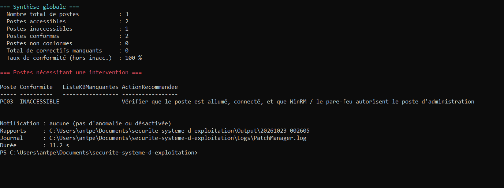{width=15cm}

---

## 10. Limites et améliorations possibles

- **Remédiation simplifiée** : le bonus installe les correctifs poste par poste. En production, on
  ajouterait des fenêtres de maintenance, un déploiement progressif (d'abord un groupe pilote) et un
  rôle JEA dédié à la remédiation.
- **Correctifs cumulatifs** : une politique fondée sur des numéros de KB doit suivre le remplacement des
  correctifs. Une variante plus robuste comparerait le **numéro de build et sa révision** (UBR, déjà
  collecté) à une version minimale.
- **Identifiants** : en production, gMSA ou coffre-fort de secrets plutôt que DPAPI local.
- **Notification** : migration vers Microsoft Graph, un SIEM ou un outil de gestion des tickets.
- **Échelle** : au-delà de quelques centaines de postes, utiliser un inventaire issu d'Active Directory
  et des outils dédiés (MECM, Intune).

---

## 11. Conclusion

Le projet fournit une chaîne complète et automatisée de Patch Management : inventaire, collecte à
distance robuste et parallèle, contrôle de conformité, rapport CSV/HTML, journal et notification
conditionnelle. La sécurité a été intégrée à chaque niveau, en appliquant les principes vus en cours :
**minimisation** (pare-feu limité au poste d'administration, `TrustedHosts` restreint), **moindre
privilège** (compte non administrateur et JEA limité à une fonction en lecture seule), **défense en
profondeur** (chiffrement, authentification, ACL, intégrité SHA-256, journalisation PowerShell) et
**veille et maintenance** (politique révisable, audit planifiable, code de sortie exploitable par la
supervision). En bonus, la boucle est fermée par la **remédiation** des postes non conformes et par le
**suivi de la conformité dans le temps**. La qualité est vérifiée en continu par 50 tests automatisés et
par un audit réel exécuté sous Windows à chaque modification du code.

---

### Annexe — Commandes principales

```powershell
.\Invoke-PatchAudit.ps1 -Credential (Get-Credential) -OpenReport   # audit complet
.\scripts\Partie1-TestParc.ps1                                     # disponibilité
.\scripts\Partie2-Inventaire.ps1 -Credential $cred                 # inventaire
.\scripts\Partie3-Correctifs.ps1 -Credential $cred                 # correctifs
.\scripts\Partie4-Conformite.ps1 -Credential $cred                 # conformité
.\scripts\Rechercher-KB.ps1 -KB KB5034441 -Credential $cred        # recherche d'un KB
.\scripts\Partie8-AuditRemoting.ps1 -Credential $cred              # audit de sécurité WinRM
.\scripts\Verifier-Integrite.ps1                                   # intégrité de tous les audits
.\scripts\Bonus-Remediation.ps1 -Credential $cred -AuditAfter        # bonus : correction puis nouvel audit
Invoke-Pester -Path .\tests -Output Detailed                       # tests
```
